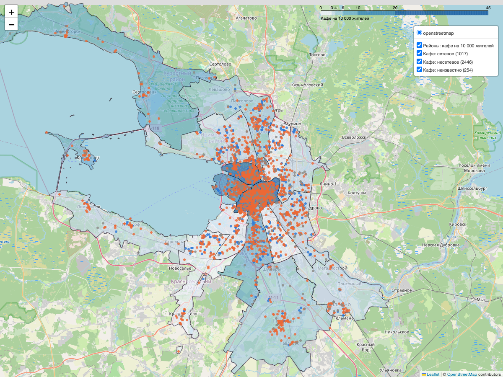
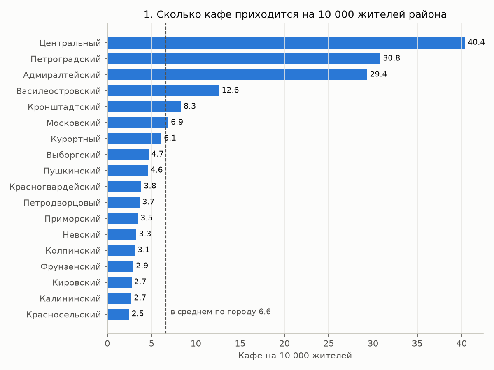
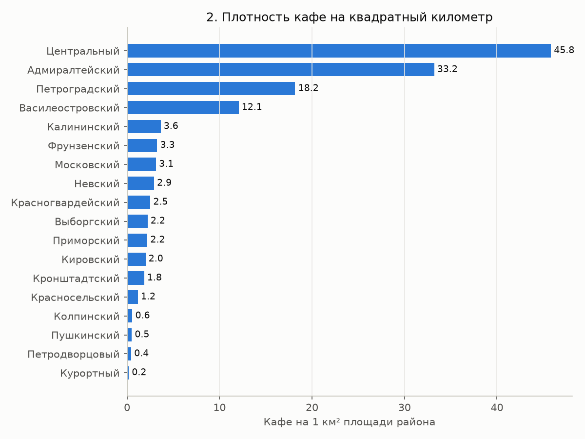
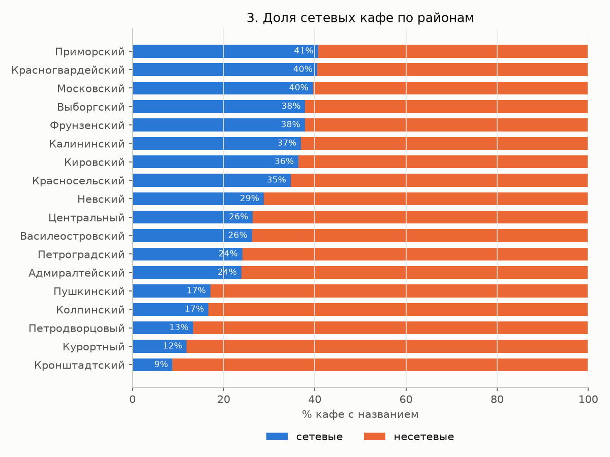

# Кафе Петербурга по районам



Я посчитала, сколько кафе приходится на жителей и на площадь в каждом из 18 районов Петербурга, и нарисовала интерактивную карту. Вопрос проекта: в каких районах кафе много, а в каких мало? Ответ пригодится, например, тому, кто выбирает место для новой кофейни.

Карта лежит в [results/coffee_map.html](results/coffee_map.html). Скачайте файл и откройте в браузере: при наведении на район видны его показатели, при наведении на точку название кафе, слои можно включать и выключать.

## Данные

Снимок данных я скачала 4 ноября 2026 года, он лежит в [data/raw/](data/raw/) (подробности в [data/README.md](data/README.md)).

- **Кафе.** Все объекты с тегом `amenity=cafe` из [OpenStreetMap](https://www.openstreetmap.org) (OSM, открытой карты мира, которую заполняют добровольцы). Я скачала их через Overpass API, бесплатный сервис для запросов к OSM. Лицензия OSM [ODbL](https://opendatacommons.org/licenses/odbl/) разрешает использование с подписью «© участники OpenStreetMap».
- **Границы районов.** Тоже из OSM.
- **Население районов.** Из [Wikidata](https://www.wikidata.org), открытой базы фактов с лицензией CC0 (без ограничений). Там есть население всех 18 районов на 1 января 2023 года, в сумме 5 600 044 человека. Благодаря этому я смогла считать кафе не только на км², но и на 10 000 жителей.

**Районы в OSM.** У каждой административной границы в OSM есть уровень `admin_level`, и чем больше число, тем мельче территория. В России `2` означает страну, `4` субъект РФ (Петербург как город федерального значения сам является субъектом), `5` районы города (их 18), `8` муниципальные образования внутри районов: округа, посёлки, города вроде Пушкина и Колпина (их 111). Я взяла уровень 5: для районов есть население, и это привычное деление города. Район в OSM хранится как relation, набор линий, из которых скрипт собирает многоугольник.

## Что я сделала

1. Скачала данные ([scripts/01_download_data.py](scripts/01_download_data.py)). Кафе я брала в прямоугольнике с запасом вокруг города, чтобы потом отсеять точки за его границей.
2. Проверила качество и почистила данные ([scripts/02_clean.py](scripts/02_clean.py), журнал в [results/01_cleaning_log.txt](results/01_cleaning_log.txt)):

   | Что | Сколько | Что сделала |
   |---|---|---|
   | Объекты `amenity=cafe` в прямоугольнике | 4 162 | |
   | За границей города, в пригородах Ленобласти | 431 | убрала |
   | Дубли: то же название ближе 50 м (например, кафе нарисовано и точкой, и зданием) | 14 | убрала |
   | Без названия | 254 (6,8%) | оставила в подсчёте, но в сетевые и несетевые не отнесла |
   | Осталось | 3 717 | |

3. Привязала каждое кафе к району через пространственное соединение (spatial join): для каждой точки GeoPandas находит район, внутри которого она лежит.
4. Посчитала показатели по районам ([scripts/03_analysis.py](scripts/03_analysis.py), таблица в [results/02_districts.csv](results/02_districts.csv)): число кафе, кафе на 10 000 жителей, кафе на 1 км² и долю сетевых. Площадь считала в метрической проекции UTM 36N, чтобы получить квадратные метры.

   Сетевым я считала кафе, если выполняется хотя бы одно условие:
   - в OSM заполнен тег `brand`;
   - то же название (без учёта регистра и разницы «е»/«ё») встречается в городе 5 раз или чаще.

   Названия, которые описывают тип заведения («Столовая», «Шаверма», «Бистро», «Пышки», «Кафе», «Кофе с собой», «Чайхона»), сетью не считаются, даже если повторяются. Всего получилось 61 сетевое название ([results/03_top_chains.csv](results/03_top_chains.csv)). Крупнейшие сети: Baggins Coffee (190 точек), Цех85 (118), Хлебник (104), Люди любят (58), Coffee Like (50). Долю сетевых я считала только среди кафе с названием.
5. Нарисовала интерактивную карту и 3 графика ([scripts/04_map_and_plots.py](scripts/04_map_and_plots.py)).

## Выводы

Числа взяты из [results/04_summary.txt](results/04_summary.txt) и [results/02_districts.csv](results/02_districts.csv).

1. В трёх исторических районах (Центральном, Адмиралтейском и Петроградском) 1 626 кафе, или 43,7% всех кафе города. Живёт там 8,4% горожан, а занимают эти районы 3,5% площади.
2. Больше всего кафе на жителя в Центральном районе: 40,4 на 10 000 человек. Следом идут Петроградский (30,8) и Адмиралтейский (29,4). По городу в среднем 6,6.
3. Меньше всего кафе на жителя в спальных районах: Красносельском (2,5), Калининском (2,7), Кировском (2,7) и Фрунзенском (2,9). Первое и последнее место отличаются в 16,5 раза. В Калининском районе живёт 537 тысяч человек, в 2,7 раза больше, чем в Центральном, а кафе там в 5,6 раза меньше (146 против 811).
4. Сетевых кафе 29,4% среди кафе с названием (1 017 из 3 463). В центре их 24–26%, в спальных районах больше: в Приморском 41%, в Красногвардейском и Московском по 40%.
5. Если мерить на жителя, меньше всего кафе в больших спальных районах: Красносельском, Калининском, Кировском, Фрунзенском, Приморском и Невском. Свободный спрос там из этого не следует. В центр люди приезжают работать, учиться и гулять, а рядом с домом могут вообще не покупать кофе.

## Ограничения

- OSM заполняют добровольцы, и полнота карты в разных районах может различаться. Часть разницы между районами может объясняться этим, а не реальным числом кафе.
- Тег `amenity=cafe` ставят не только кофейням, но и пекарням, столовым и шавермам. После очистки в данных 61 заведение со словом «столовая» в названии и 32 со словами «шаверма» или «шаурма». Отделить кофейни надёжно не получилось: тег `cuisine=coffee_shop` есть только у 1 109 из 3 717 точек (30%). Поэтому я считала все кафе.
- Население взято на 1 января 2023 года, кафе на ноябрь 2026. К тому же «жители» означает прописанных в районе, а днём в центр приезжает много людей из других районов. Поэтому показатель «кафе на 10 000 жителей» для центра завышен.
- В площадь района входят вода, леса и промзоны. У Курортного района 274 км², включая леса и участок Финского залива, поэтому плотность на км² там очень низкая.
- Правило для сетей приблизительное. Разные независимые кафе с одинаковым простым названием (например, «Венеция» или «Мечта») могут попасть в «сети». Маленькие сети с 2–4 точками без тега `brand` попадут в несетевые. Разные написания одной сети («Этлон кофе» и «Etlon Coffee») идут как разные названия, хотя обе попадают в сетевые.
- У Кронштадтского района ссылка на Wikidata в OSM ведёт на город Кронштадт. Район состоит из этого города, так что население совпадает.
- Данные показывают, где кафе больше, но не объясняют почему.

## Как запустить

Нужен Python 3.10 или новее.

```bash
python3 -m venv .venv && source .venv/bin/activate
pip install -r requirements.txt
python run_all.py
```

Скрипт берёт снимок данных из `data/raw/`, так что интернет нужен только для подложки карты в браузере. Результаты появятся в `results/` и `figures/`. Скриншот карты я сделала через Chrome без окна: `"/Applications/Google Chrome.app/Contents/MacOS/Google Chrome" --headless=new --window-size=1200,900 --virtual-time-budget=20000 --screenshot=figures/map_screenshot.png <адрес карты>`.

## Графики

**1. Кафе на 10 000 жителей.** Три центральных района сильно впереди, у большинства спальных меньше 4.



**2. Кафе на 1 км².** Центр снова впереди. У пригородных районов (Курортного, Пушкинского, Петродворцового) плотность низкая из-за большой площади.



**3. Доля сетевых кафе.** В спальных районах сетей больше 35%, в центре около четверти, в пригородах меньше пятой части.



## Структура проекта

```
README.md
requirements.txt
run_all.py                     запуск всех шагов
data/raw/                      снимок данных OSM и Wikidata
scripts/01_download_data.py    скачивание (только с флагом --refresh)
scripts/02_clean.py            сборка районов, очистка, привязка к районам
scripts/03_analysis.py         показатели по районам, сетевые и несетевые
scripts/04_map_and_plots.py    интерактивная карта и графики
results/                       карта coffee_map.html и таблицы
figures/                       графики и скриншот карты
```

## Словарик

- **OpenStreetMap (OSM).** Открытая карта мира. Её рисуют добровольцы, как Википедию.
- **Тег.** Подпись к объекту в OSM вида «ключ=значение». Например, `amenity=cafe` означает «кафе».
- **Overpass API.** Бесплатный сервис: отправляешь запрос «все кафе в этом прямоугольнике» и получаешь данные.
- **admin_level.** Уровень административной границы в OSM. Чем больше число, тем мельче территория.
- **Wikidata.** Открытая база фактов (население, даты, координаты), связанная с Википедией.
- **Плотность.** Число объектов на единицу: на 1 км² или на 10 000 жителей.
- **Кафе на 10 000 жителей.** Число кафе, делённое на население и умноженное на 10 000. Так можно сравнивать районы разного размера.
- **Пространственное соединение (spatial join).** Объединение таблиц по положению на карте, например «эта точка лежит внутри этого района».
- **Проекция.** Способ перенести поверхность Земли на плоскость. В метрической проекции расстояния и площади считаются в метрах.
- **GeoJSON.** Формат файлов для географических данных: точек, линий, многоугольников.
- **Дубль.** Один объект, записанный дважды.
- **Сетевое кафе.** Кафе, у которого под тем же брендом есть другие точки.
- **Хороплет (choropleth).** Карта, где районы закрашены по значению показателя: чем темнее, тем больше.
